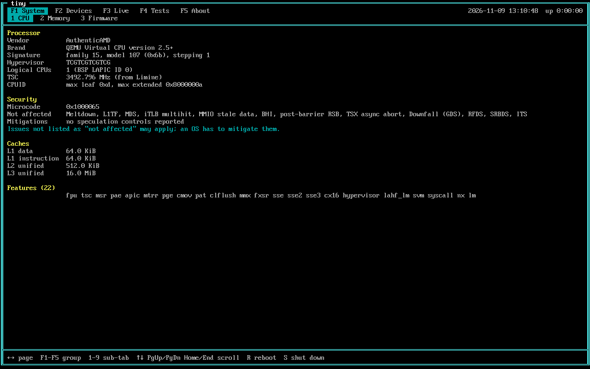
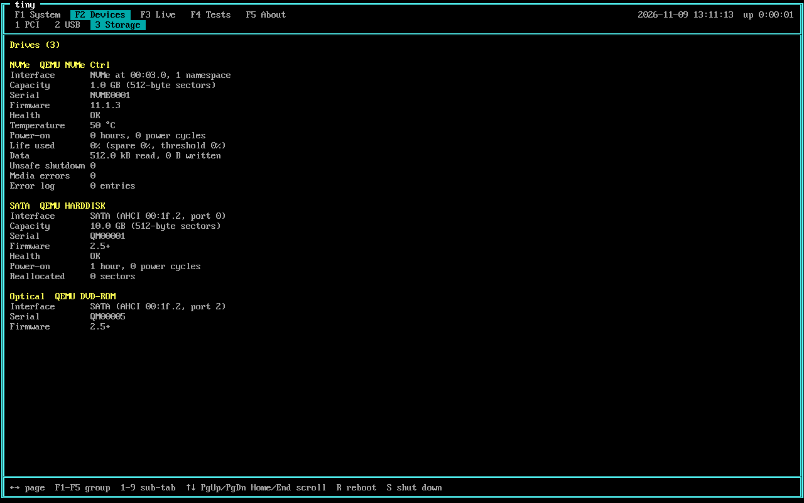
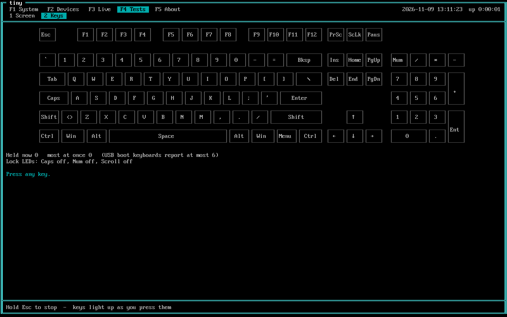
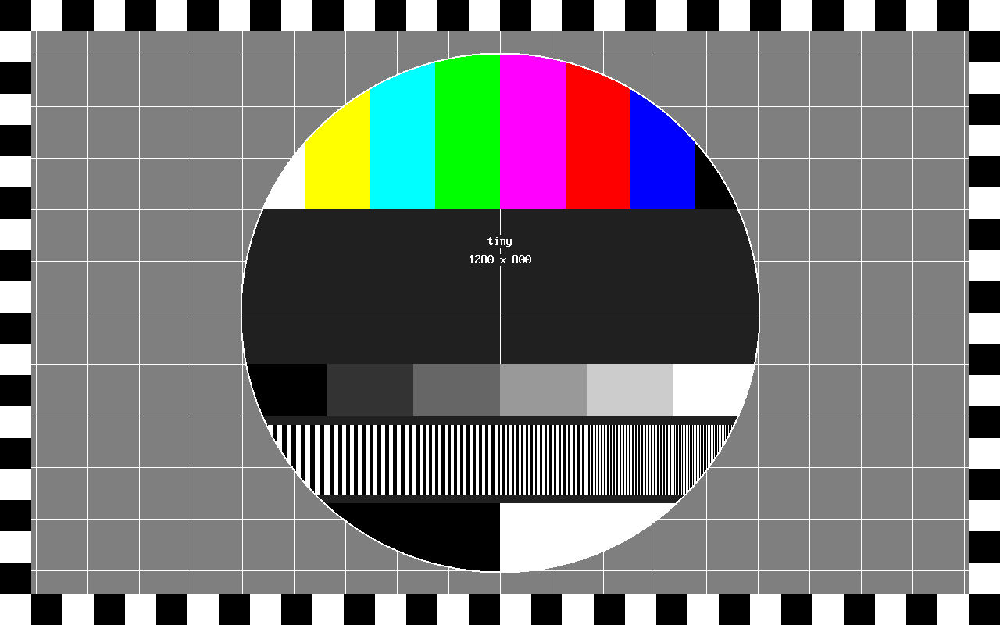

# tiny

tiny is a small bare-metal x86_64 kernel that boots from a USB stick, probes the
machine and shows what it found in a text UI. There is no OS underneath: it is
a freestanding C kernel booted by [Limine](https://github.com/Limine-Bootloader/Limine),
and one ISO works on both BIOS and UEFI machines.



It shows:

- the CPU (CPUID, caches, features, TSC, microcode, speculative-execution status)
- the memory map and installed RAM
- PCI devices with vendor and device names, and USB devices
- NVMe and SATA drives with their SMART health
- the firmware (BIOS/UEFI, SMBIOS, ACPI tables, RTC) and the monitor's EDID
- live CPU temperature and clock, and its own log
- a keyboard tester and a display tester

Input works from a PS/2 or USB keyboard and a USB mouse, with USB hotplug.

## Quick start

You need `clang`, `ld.lld`, `nasm`, `xorriso`, `git`, `make` and
`qemu-system-x86_64`. Then:

```sh
make run
```

The first build clones and builds Limine v11.4.1 into `limine/`. The serial log
goes to your terminal.

## Pages and keys

Pages are grouped under the function keys:

| Key | Group | Pages |
|---|---|---|
| F1 | System | CPU, Memory, Firmware |
| F2 | Devices | PCI, USB, Storage |
| F3 | Live | Sensors, Log |
| F4 | Tests | Screen, Keys |
| F5 | About | About |

| Key | Action |
|---|---|
| F1 to F5 | switch group; the same key again goes to the group's next page |
| 1 to 9 | page within the current group |
| ← / → | previous / next page, through all groups |
| ↑ / ↓, PgUp / PgDn, Home / End | scroll |
| R, then R again | reboot |
| S, then S again | shut down (ACPI S5) |

With a USB mouse, the wheel scrolls and clicking a group or page label switches
to it. The pointer is a highlighted cell that appears when the mouse moves.

### System

**CPU** shows vendor, model, caches, feature flags and the TSC frequency. Its
Security section lists the loaded microcode revision, the speculative-execution
issues the CPU says it is not affected by (Intel's IA32_ARCH_CAPABILITIES bits;
on AMD, CPUID bits plus the issues no AMD CPU has), and the speculation controls
it offers (IBRS/IBPB, STIBP, SSBD, MD_CLEAR, ...). Anything not listed as
unaffected may apply. With no OS running, nothing is mitigated.

**Memory** shows the firmware memory map and the installed DIMMs from SMBIOS.

**Firmware** shows BIOS or UEFI, SMBIOS system and board info, the ACPI tables,
the RTC and the monitor's EDID.

### Devices

**PCI** lists every PCI function with its class and the vendor and device names
from a built-in copy of [pci.ids](https://pci-ids.ucw.cz/) (all vendors and
devices, no subsystems). The names also go to the log at boot.

**USB** lists each xHCI controller (version, USB 2 and USB 3 port counts) and
every device that answered on its ports: port, speed, vid:pid, class, the
product name the device reports, and whether tiny uses it (keyboard, mouse, hub).
Devices that failed to come up are listed in red. The list follows plugging and
unplugging. Devices behind a hub's USB 3 half or behind a second level of hubs
are not seen.

**Storage** lists NVMe drives and SATA drives on AHCI controllers: model, serial,
firmware, capacity, and health from the drive's own SMART data (NVMe health log;
ATA SMART status plus reallocated, pending and uncorrectable sectors,
temperature and power-on hours).



tiny only sends identify and health-log commands and never reads or writes disk
data. Once a drive has been read, NVMe drives get a normal shutdown and SATA
drives a STANDBY IMMEDIATE (hard disks spin down a few seconds into boot), so
however the machine is turned off afterwards, it doesn't add to their
unsafe-shutdown count. Drives behind RAID or Intel VMD controllers can't be
seen; switch the firmware's storage mode to AHCI.

### Live

**Sensors** shows the CPU temperature (Intel core and package sensors with
TjMax; AMD Tctl) and the effective clock from APERF/MPERF, refreshed every
second with a two-minute graph of each. Only the boot CPU is read, and tiny
keeps it busy, so these are the readings of one loaded core. Virtual machines
usually have no readable sensors.

**Log** shows everything tiny logged, with timestamps (the same lines as the
serial port). On a machine without a serial port, this is where to look when a
controller or device didn't come up. Problem lines are red, and the view
follows new lines while it is scrolled to the bottom.

### Tests

**Keys** is a keyboard tester. It draws a full-size keyboard (plus the ISO key
next to left Shift), lights up keys while they are held and marks the ones that
have been pressed. It counts how many keys are held at once, for checking
ghosting and rollover (USB boot keyboards report at most 6), and lists the raw
events: PS/2 scancode bytes, or the USB HID usage and port. Caps, Num and
Scroll Lock toggle the keyboard's LEDs.

The tester starts idle behind a "press Enter to start" box, so ← / → walk past
it like any other page. After **Enter** every key goes to the tester. Hold
**Esc** for a second to stop (the marks stay for the next run), or click
another page or group.



**Screen** is a display tester. It shows the framebuffer mode tiny got next to
the monitor's preferred mode from EDID, and warns when they differ (the screen
is then scaling, so 1-px patterns look soft). **Enter** starts the full-screen
patterns:

- a test card in the style of Test Card F: colour bars, grey steps, gratings
  from 6 px down to 1 px, a grid and a castellated edge
- solid black, white, red, green, blue and 50% grey, for dead and stuck pixels,
  backlight bleed and uniformity
- red, green, blue and grey ramps, for banding
- a 1-px checkerboard, for scaling blur
- a 32-px grid whose red line is the outermost pixel row and column, for
  overscan cropping

Space, →, PgDn or a left click goes to the next pattern; Backspace, ←, PgUp or a
right click goes back. Esc or Q, or stepping past the last pattern, returns to
the page.



### Shutting down

After R R or S S, tiny says goodbye before the machine goes off: about a second
of ULTRAKILL's dying V1 diagnostic log (an homage), line by line in orange and
red, on a failing-VCR picture. New lines shake with colour fringes, bands tear
sideways or turn to static as shutdown nears, and it ends with a CRT switch-off.
The `nofarewell` command-line word turns it off.

## Boot menu

The Limine menu has three entries:

| Entry | Command line | Use it when |
|---|---|---|
| tiny | | normally |
| tiny (no USB) | `nousb` | the USB driver misbehaves; tiny leaves the USB controllers alone and relies on the firmware's PS/2 emulation |
| tiny (safe mode: no USB, no storage) | `nousb nostorage nofarewell` | a storage controller misbehaves too |

On machines whose firmware has no PS/2 emulation, use the normal entry and plug
in a USB keyboard. tiny handles keyboards on a root port or behind one hub.

## Running on real hardware

Write the ISO to a USB stick. **This erases the stick**, so check the device
name with `lsblk` first:

```sh
sudo dd if=build/tiny.iso of=/dev/sdX bs=4M conv=fsync status=progress
```

Boot from it in BIOS/CSM or UEFI mode. Secure Boot must be off.

## Building

Requirements:

- `clang`, `ld.lld`, `nasm`, `xorriso`, `git`, `make` for the ISO
- `gcc` for the host unit tests
- `qemu-system-x86_64` and OVMF for running it (OVMF is found under
  `/usr/share/edk2`, or set `OVMF_CODE` and `OVMF_VARS`)
- Python 3 for the tools in `tools/`

On Gentoo, `emerge dev-libs/libisoburn sys-firmware/edk2-bin` covers the less
common ones.

```sh
make            # build/tiny.iso
make run        # QEMU, legacy BIOS, serial log on stdout
make run-uefi   # QEMU, UEFI (OVMF)
make run-usb    # QEMU with PS/2 off and a USB keyboard on xHCI
make test       # host unit tests (gcc, ASan + UBSan)
make smoke      # headless QEMU boot tests, see below
make shots      # PNG screenshots of every page into build/shots/
make help       # list of targets and options
```

`make smoke` boots the ISO in QEMU several ways (BIOS, UEFI, panic, no PS/2, no
ACPI, shutdown, `nousb`, with NVMe and SATA disks) and checks the serial log. It
also drives USB key tests over QMP: root port, behind a hub, and hotplug.

## Source layout

| Path | Contents |
|---|---|
| `src/main.c` | boot sequence |
| `src/boot.c` | Limine requests |
| `src/arch/` | IDT, exception handling, x86 helpers |
| `src/mm/` | DMA page pool, MMIO mapping, BAR helpers |
| `src/info/` | hardware probing and table parsing, NVMe and AHCI identify/SMART |
| `src/usb/` | xHCI driver, enumeration, hubs, HID boot keyboard and mouse |
| `src/input/` | PS/2 driver and the shared input queue |
| `src/gfx/` | framebuffer text grid, direct drawing for the screen test |
| `src/ui/` | pages, groups, main loop |
| `src/lib/` | formatting, serial, log buffer, command line, panic |
| `tests/` | host unit tests and the QEMU smoke test script |
| `tools/` | generators for the embedded tables and QEMU helpers |

Hardware access is kept apart from parsing and formatting, so the pure parts
(CPUID decoding, PCI, USB descriptors, ACPI/SMBIOS/EDID parsing, page builders
and so on) build and run as host unit tests.

Three source files are generated and shouldn't be edited by hand:

- `src/info/pci_ids.c` by `tools/pciids2c.py [pci.ids]` (default
  `/usr/share/hwdata/pci.ids`)
- `src/gfx/font8x16.c` by `tools/extract-font.py [VGABIOS]`
- `src/ui/about_art.{c,h}` by `tools/art2c.py [assets/ascii.txt]`

Planned work is in [docs/MILESTONES.md](docs/MILESTONES.md).

## License

tiny is licensed under the [PolyForm Noncommercial License 1.0.0](LICENSE.md).
Personal, hobby, research and educational use is free, as is use by charities,
schools and public bodies. Any commercial use needs a separate license; open an
issue on GitHub to ask.

Third-party parts keep their own licenses, listed below.

## Credits

- [Limine](https://github.com/Limine-Bootloader/Limine) bootloader
  (BSD-2-Clause); `src/limine.h` is 0BSD.
- PCI vendor and device names come from the
  [PCI ID Repository](https://pci-ids.ucw.cz/), used under its 3-clause BSD
  license option.
- The IBM VGA 8x16 font is extracted from QEMU's SeaBIOS VGA BIOS by
  `tools/extract-font.py`.
